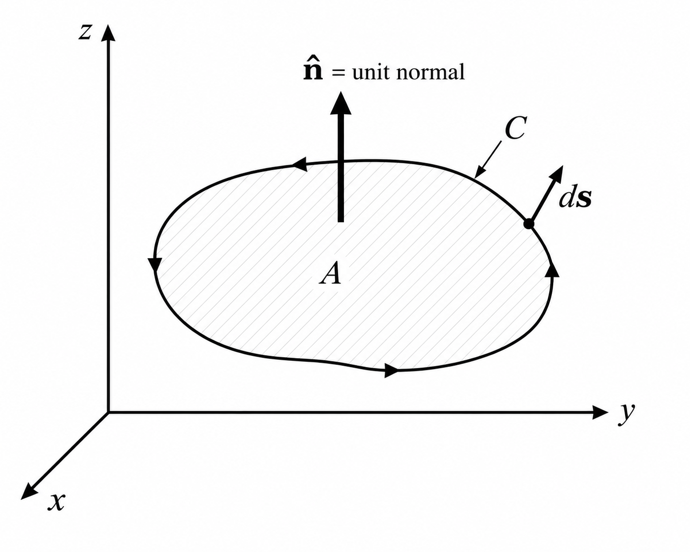
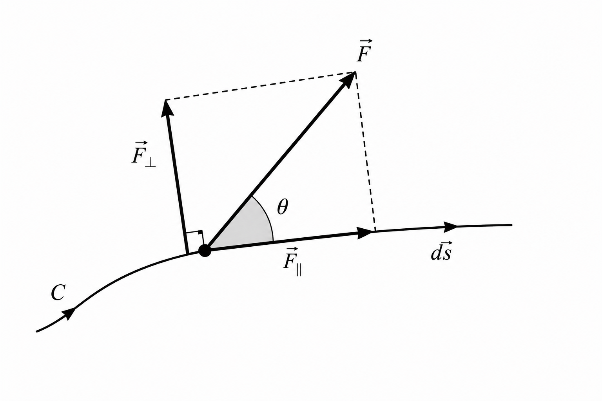

# Derivation of Curl

Generalized Stokes' Theorem. Let $\Omega$ be a smooth oriented $n$-dimensional manifold with boundary $\partial\Omega$, and let $\omega$ be a differential $(n-1)$-form on $\Omega$. Then

$$
\int_{\partial\Omega}\omega
=
\int_{\Omega}d\omega.
$$

where

- $\omega$ is a differential $(n-1)$-form on $\Omega$.
- $d\omega$ is the exterior derivative of $\omega$.
- $\Omega$ is a smooth oriented manifold.
- $\partial\Omega$ is the boundary of $\Omega$.

Vector Form. In three-dimensional Cartesian space, let

$$
\mathbf{F}
=
F_x\mathbf{i}
+
F_y\mathbf{j}
+
F_z\mathbf{k}.
$$

Associate $\mathbf{F}$ with the differential $1$-form

$$
\omega
=
F_x\,dx
+
F_y\,dy
+
F_z\,dz.
$$

Its exterior derivative is

$$
d\omega
=
dF_x\wedge dx
+
dF_y\wedge dy
+
dF_z\wedge dz.
$$

Expanding,

$$
\begin{aligned}
d\omega
&=
\left(
\dfrac{\partial F_y}{\partial x}
-
\dfrac{\partial F_x}{\partial y}
\right)
dx\wedge dy
\\[4pt]
&\quad+
\left(
\dfrac{\partial F_z}{\partial y}
-
\dfrac{\partial F_y}{\partial z}
\right)
dy\wedge dz
\\[4pt]
&\quad+
\left(
\dfrac{\partial F_x}{\partial z}
-
\dfrac{\partial F_z}{\partial x}
\right)
dz\wedge dx.
\end{aligned}
$$

For a surface $S$ with boundary $C=\partial S$,

$$
\int_{\partial S}\omega
=
\oint_C\mathbf{F}\cdot d\mathbf{s},
$$

and

$$
\int_S d\omega
=
\iint_S
(\nabla\times\mathbf{F})\cdot\hat{\mathbf{n}}
\,dA.
$$

Thus the generalized Stokes theorem becomes

$$
\oint_C\mathbf{F}\cdot d\mathbf{s}
=
\iint_S
(\nabla\times\mathbf{F})\cdot\hat{\mathbf{n}}
\,dA.
$$

Dividing by the area $A$ of $S$,

$$
\frac{1}{A}
\oint_C\mathbf{F}\cdot d\mathbf{s}
=
\frac{1}{A}
\iint_S
(\nabla\times\mathbf{F})\cdot\hat{\mathbf{n}}
\,dA.
$$

As $A\to0$,

$$
(\nabla\times\mathbf{F})\cdot\hat{\mathbf{n}}
=
\lim_{A\to0}
\frac{1}{A}
\oint_C\mathbf{F}\cdot d\mathbf{s}.
$$

Rectangular Loop. Consider a rectangle in the $xy$-plane centered at $(x,y,z)$, with side lengths $\Delta x$ and $\Delta y$ and unit normal

$$
\hat{\mathbf{n}}=\mathbf{k}.
$$

Let its boundary be traversed as

$$
a\to b\to c\to d\to a.
$$

All field components and derivatives below are evaluated at $(x,y,z)$.

For $a\to b$,

$$
F_x\left(x,y-\frac{\Delta y}{2},z\right)
\simeq
F_x-\frac{\Delta y}{2}\frac{\partial F_x}{\partial y}.
$$

Hence,

$$
\int_a^b\mathbf{F}\cdot d\mathbf{s}
\simeq
\left(
F_x-\frac{\Delta y}{2}\frac{\partial F_x}{\partial y}
\right)\Delta x.
$$

For $b\to c$,

$$
F_y\left(x+\frac{\Delta x}{2},y,z\right)
\simeq
F_y+\frac{\Delta x}{2}\frac{\partial F_y}{\partial x}.
$$

Hence,

$$
\int_b^c\mathbf{F}\cdot d\mathbf{s}
\simeq
\left(
F_y+\frac{\Delta x}{2}\frac{\partial F_y}{\partial x}
\right)\Delta y.
$$

For $c\to d$,

$$
F_x\left(x,y+\frac{\Delta y}{2},z\right)
\simeq
F_x+\frac{\Delta y}{2}\frac{\partial F_x}{\partial y}.
$$

Hence,

$$
\int_c^d\mathbf{F}\cdot d\mathbf{s}
\simeq
-\left(
F_x+\frac{\Delta y}{2}\frac{\partial F_x}{\partial y}
\right)\Delta x.
$$

For $d\to a$,

$$
F_y\left(x-\frac{\Delta x}{2},y,z\right)
\simeq
F_y-\frac{\Delta x}{2}\frac{\partial F_y}{\partial x}.
$$

Hence,

$$
\int_d^a\mathbf{F}\cdot d\mathbf{s}
\simeq
-\left(
F_y-\frac{\Delta x}{2}\frac{\partial F_y}{\partial x}
\right)\Delta y.
$$

First-Order Taylor Expansion. For example,

$$
F_y(x+h,y,z)
\simeq
F_y(x,y,z)
+
h\frac{\partial F_y}{\partial x},
$$

where

$$
h=\frac{\Delta x}{2}.
$$

Therefore,

$$
F_y\left(x+\frac{\Delta x}{2},y,z\right)
\simeq
F_y(x,y,z)
+
\frac{\Delta x}{2}
\frac{\partial F_y}{\partial x}.
$$

Thus,

$$
F_y\left(x+\frac{\Delta x}{2},y,z\right)
\simeq
F_y
+
\frac{\Delta x}{2}
\frac{\partial F_y}{\partial x}.
$$

Circulation. Summing the four sides,

$$
\begin{aligned}
\oint_{abcd}\mathbf{F}\cdot d\mathbf{s}
\simeq {}&
\left(
F_x-\frac{\Delta y}{2}\frac{\partial F_x}{\partial y}
\right)\Delta x
\\
&+
\left(
F_y+\frac{\Delta x}{2}\frac{\partial F_y}{\partial x}
\right)\Delta y
\\
&-
\left(
F_x+\frac{\Delta y}{2}\frac{\partial F_x}{\partial y}
\right)\Delta x
\\
&-
\left(
F_y-\frac{\Delta x}{2}\frac{\partial F_y}{\partial x}
\right)\Delta y.
\end{aligned}
$$

The $F_x$ and $F_y$ terms cancel, giving

$$
\oint_{abcd}\mathbf{F}\cdot d\mathbf{s}
\simeq
\left(
\frac{\partial F_y}{\partial x}
-
\frac{\partial F_x}{\partial y}
\right)
\Delta x\,\Delta y.
$$

Since

$$
A=\Delta x\,\Delta y,
$$

we obtain

$$
\frac{1}{A}
\oint_{abcd}\mathbf{F}\cdot d\mathbf{s}
\simeq
\frac{\partial F_y}{\partial x}
-
\frac{\partial F_x}{\partial y}.
$$

Taking $\Delta x,\Delta y\to0$,

$$
(\nabla\times\mathbf{F})\cdot\mathbf{k}
=
\frac{\partial F_y}{\partial x}
-
\frac{\partial F_x}{\partial y}.
$$

Therefore,

$$
(\nabla\times\mathbf{F})_z
=
\frac{\partial F_y}{\partial x}
-
\frac{\partial F_x}{\partial y}.
$$

Cyclic Permutation. Cycling the coordinates gives

$$
(\nabla\times\mathbf{F})_x
=
\frac{\partial F_z}{\partial y}
-
\frac{\partial F_y}{\partial z},
$$

$$
(\nabla\times\mathbf{F})_y
=
\frac{\partial F_x}{\partial z}
-
\frac{\partial F_z}{\partial x},
$$

and

$$
(\nabla\times\mathbf{F})_z
=
\frac{\partial F_y}{\partial x}
-
\frac{\partial F_x}{\partial y}.
$$

Component Form. Therefore,

$$
\nabla\times\mathbf{F}
=
\left(
\frac{\partial F_z}{\partial y}
-
\frac{\partial F_y}{\partial z}
\right)\mathbf{i}
+
\left(
\frac{\partial F_x}{\partial z}
-
\frac{\partial F_z}{\partial x}
\right)\mathbf{j}
+
\left(
\frac{\partial F_y}{\partial x}
-
\frac{\partial F_x}{\partial y}
\right)\mathbf{k}.
$$

Determinant Form. The vector differential operator is

$$
\nabla
=
\mathbf{i}\frac{\partial}{\partial x}
+
\mathbf{j}\frac{\partial}{\partial y}
+
\mathbf{k}\frac{\partial}{\partial z}.
$$

The component form of curl is represented by the symbolic determinant

$$
\nabla\times\mathbf{F}
=
\begin{vmatrix}
\mathbf{i} & \mathbf{j} & \mathbf{k} \\
\dfrac{\partial}{\partial x} &
\dfrac{\partial}{\partial y} &
\dfrac{\partial}{\partial z} \\
F_x & F_y & F_z
\end{vmatrix}.
$$

Expanding,

$$
\nabla\times\mathbf{F}
=
\mathbf{i}
\left(
\frac{\partial F_z}{\partial y}
-
\frac{\partial F_y}{\partial z}
\right)
-
\mathbf{j}
\left(
\frac{\partial F_z}{\partial x}
-
\frac{\partial F_x}{\partial z}
\right)
+
\mathbf{k}
\left(
\frac{\partial F_y}{\partial x}
-
\frac{\partial F_x}{\partial y}
\right).
$$

Equivalently,

$$
\operatorname{curl}\mathbf{F}
=
\nabla\times\mathbf{F}.
$$

Curl is also written $\operatorname{rot}\mathbf{F}$. The determinant above is a symbolic determinant.

{#fig:closed-curve-vector-field}

{#fig:vector-decomposition-along-curved-path}

## References

1. Kreyszig, E. *Advanced Engineering Mathematics*, 10th ed. Wiley, 2011. — curl as circulation per unit area; symbolic determinant $\nabla\times\mathbf{F}$; Cartesian expansion.

2. Boas, M. L. *Mathematical Methods in the Physical Sciences*. — normal component of curl as the limit of circulation per unit area.

3. Feynman, R. P., Leighton, R. B., & Sands, M. *The Feynman Lectures on Physics*, Vol. II. — circulation around a square of sides $\Delta x$ and $\Delta y$ in the $xy$-plane; identification with $(\nabla\times\mathbf{C})\cdot\hat{\mathbf{n}}\,\Delta a$.

4. Riley, K. F., Hobson, M. P., & Bence, S. J. *Mathematical Methods for Physics and Engineering*. — determinantal form; the partial derivatives in the second row act on the components in the third row.