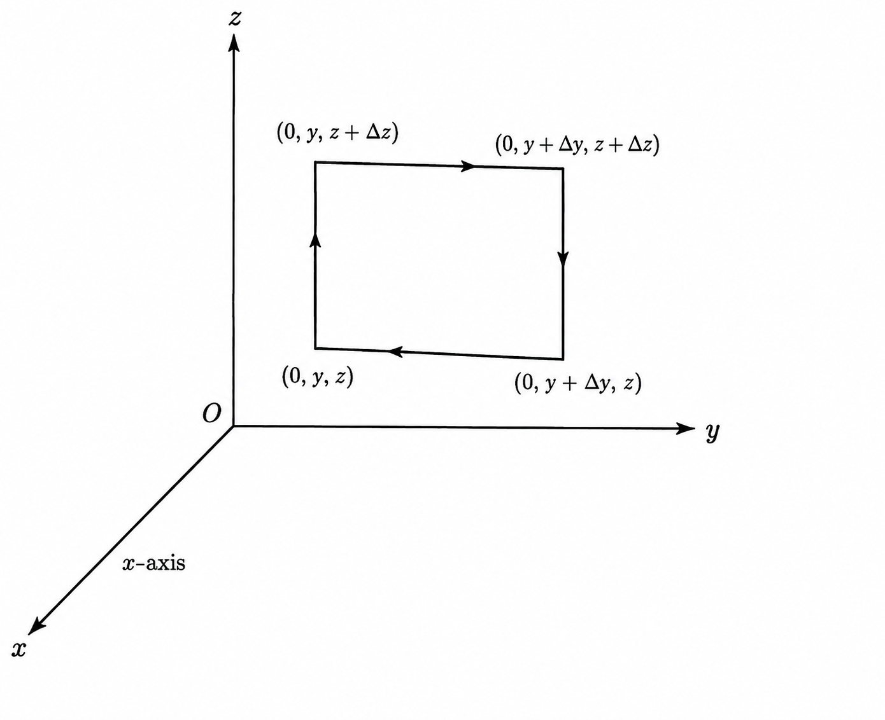

# Derivation of Curl

$\displaystyle \operatorname{curl} \mathbf{F} = \nabla \times \mathbf{F} = \begin{vmatrix} \mathbf{i} & \mathbf{j} & \mathbf{k} \\ \dfrac{\partial}{\partial x} & \dfrac{\partial}{\partial y} & \dfrac{\partial}{\partial z} \\ F_{x} & F_{y} & F_{z} \end{vmatrix}$

$$
\begin{align*}
\mathbf{F}
&=
F_x\mathbf{i}+F_y\mathbf{j}+F_z\mathbf{k}
\end{align*}
$$

Start from a Cartesian vector field

where

- $\mathbf{F}$ is a vector field.
- $F_x$ is the $x$-component of $\mathbf{F}$.
- $F_y$ is the $y$-component of $\mathbf{F}$.
- $F_z$ is the $z$-component of $\mathbf{F}$.
- $\mathbf{i}$ is the unit vector along $x$.
- $\mathbf{j}$ is the unit vector along $y$.
- $\mathbf{k}$ is the unit vector along $z$.

$$
\begin{align*}
X
&=
\dfrac{\partial F_z}{\partial y}-\dfrac{\partial F_y}{\partial z}
\\
Y
&=
\dfrac{\partial F_x}{\partial z}-\dfrac{\partial F_z}{\partial x}
\\
Z
&=
\dfrac{\partial F_y}{\partial x}-\dfrac{\partial F_x}{\partial y}
\end{align*}
$$

Define the three Cartesian differential components

where

- $X$ is the differential component along $x$.
- $Y$ is the differential component along $y$.
- $Z$ is the differential component along $z$.
- $x$, $y$, $z$ are Cartesian coordinates.
- $\partial$ denotes partial differentiation.

$$
\begin{align*}
\mathbf{R}
&=
X\mathbf{i}+Y\mathbf{j}+Z\mathbf{k}
\end{align*}
$$

Assemble those components into one vector

where

- $\mathbf{R}$ is the resulting vector field.
- $X$, $Y$, $Z$ are its Cartesian components.

$$
\begin{align*}
\mathbf{R}
&=
\biggl(\dfrac{\partial F_z}{\partial y}-\dfrac{\partial F_y}{\partial z}\biggr)\mathbf{i}
+\biggl(\dfrac{\partial F_x}{\partial z}-\dfrac{\partial F_z}{\partial x}\biggr)\mathbf{j}
+\biggl(\dfrac{\partial F_y}{\partial x}-\dfrac{\partial F_x}{\partial y}\biggr)\mathbf{k}
\end{align*}
$$

Substitute the differential components

$$
\begin{align*}
\operatorname{curl}\mathbf{F}
&=
\biggl(\dfrac{\partial F_z}{\partial y}-\dfrac{\partial F_y}{\partial z}\biggr)\mathbf{i}
+\biggl(\dfrac{\partial F_x}{\partial z}-\dfrac{\partial F_z}{\partial x}\biggr)\mathbf{j}
+\biggl(\dfrac{\partial F_y}{\partial x}-\dfrac{\partial F_x}{\partial y}\biggr)\mathbf{k}
\end{align*}
$$

Name this vector the curl of F

where

- $\operatorname{curl}\mathbf{F}$ is the curl of $\mathbf{F}$.
- Each coefficient is a Cartesian curl component.

$$
\begin{align*}
(\operatorname{curl}\mathbf{F})_x
&=
\dfrac{\partial F_z}{\partial y}-\dfrac{\partial F_y}{\partial z}
\\
(\operatorname{curl}\mathbf{F})_y
&=
\dfrac{\partial F_x}{\partial z}-\dfrac{\partial F_z}{\partial x}
\\
(\operatorname{curl}\mathbf{F})_z
&=
\dfrac{\partial F_y}{\partial x}-\dfrac{\partial F_x}{\partial y}
\end{align*}
$$

Read off the three Cartesian curl components

where

- $(\operatorname{curl}\mathbf{F})_x$ is the $x$-component.
- $(\operatorname{curl}\mathbf{F})_y$ is the $y$-component.
- $(\operatorname{curl}\mathbf{F})_z$ is the $z$-component.

$$
\begin{align*}
\mathbf{a}
&=
a_1\mathbf{i}+a_2\mathbf{j}+a_3\mathbf{k}
\\
\mathbf{b}
&=
b_1\mathbf{i}+b_2\mathbf{j}+b_3\mathbf{k}
\end{align*}
$$

Write two general Cartesian vectors

where

- $\mathbf{a}$ is the first vector.
- $\mathbf{b}$ is the second vector.
- $a_1$, $a_2$, $a_3$ are components of $\mathbf{a}$.
- $b_1$, $b_2$, $b_3$ are components of $\mathbf{b}$.

$$
\begin{align*}
\mathbf{a}\times\mathbf{b}
&=
(a_2b_3-a_3b_2)\mathbf{i}
+(a_3b_1-a_1b_3)\mathbf{j}
+(a_1b_2-a_2b_1)\mathbf{k}
\end{align*}
$$

Form the cross product

where

- $\mathbf{a}\times\mathbf{b}$ is the cross product.
- Each coefficient is a Cartesian component.

$$
\begin{align*}
\nabla
&=
\mathbf{i}\dfrac{\partial}{\partial x}
+\mathbf{j}\dfrac{\partial}{\partial y}
+\mathbf{k}\dfrac{\partial}{\partial z}
\end{align*}
$$

Define the vector differential operator

where

- $\nabla$ is the vector differential operator.
- $\dfrac{\partial}{\partial x}$ differentiates with respect to $x$.
- $\dfrac{\partial}{\partial y}$ differentiates with respect to $y$.
- $\dfrac{\partial}{\partial z}$ differentiates with respect to $z$.

$$
\begin{align*}
\mathbf{a}
&=
\nabla
\\
\mathbf{b}
&=
\mathbf{F}
\end{align*}
$$

Identify the cross-product factors with nabla and the field

$$
\begin{align*}
\nabla\times\mathbf{F}
&=
\biggl(\dfrac{\partial F_z}{\partial y}-\dfrac{\partial F_y}{\partial z}\biggr)\mathbf{i}
+\biggl(\dfrac{\partial F_x}{\partial z}-\dfrac{\partial F_z}{\partial x}\biggr)\mathbf{j}
+\biggl(\dfrac{\partial F_y}{\partial x}-\dfrac{\partial F_x}{\partial y}\biggr)\mathbf{k}
\end{align*}
$$

Apply the cross-product rule

$$
\begin{align*}
\operatorname{curl}\mathbf{F}
&=
\nabla\times\mathbf{F}
\end{align*}
$$

Compare with the component form

where

- $\nabla$ supplies the differential operators.
- $\mathbf{F}$ supplies the field components.
- $\times$ applies the cross-product rule.

$$
\begin{align*}
\mathbf{a}\times\mathbf{b}
&=
\begin{vmatrix}
\mathbf{i} & \mathbf{j} & \mathbf{k} \\
a_1 & a_2 & a_3 \\
b_1 & b_2 & b_3
\end{vmatrix}
\end{align*}
$$

Write the cross product as a determinant

where

- The first row contains Cartesian unit vectors.
- The second row contains $\mathbf{a}$ components.
- The third row contains $\mathbf{b}$ components.

$$
\begin{align*}
\nabla\times\mathbf{F}
&=
\begin{vmatrix}
\mathbf{i} & \mathbf{j} & \mathbf{k} \\
\dfrac{\partial}{\partial x} & \dfrac{\partial}{\partial y} & \dfrac{\partial}{\partial z} \\
F_x & F_y & F_z
\end{vmatrix}
\end{align*}
$$

Replace the two vectors by nabla and the field

where

- The first row contains Cartesian unit vectors.
- The second row contains differential operators.
- The third row contains field components.
- The determinant is symbolic.

$$
\begin{align*}
\nabla\times\mathbf{F}
&=
\mathbf{i}
\begin{vmatrix}
\dfrac{\partial}{\partial y} & \dfrac{\partial}{\partial z} \\
F_y & F_z
\end{vmatrix}
-
\mathbf{j}
\begin{vmatrix}
\dfrac{\partial}{\partial x} & \dfrac{\partial}{\partial z} \\
F_x & F_z
\end{vmatrix}
+
\mathbf{k}
\begin{vmatrix}
\dfrac{\partial}{\partial x} & \dfrac{\partial}{\partial y} \\
F_x & F_y
\end{vmatrix}
\end{align*}
$$

Expand the determinant

$$
\begin{align*}
\nabla\times\mathbf{F}
&=
\biggl(\dfrac{\partial F_z}{\partial y}-\dfrac{\partial F_y}{\partial z}\biggr)\mathbf{i}
-
\biggl(\dfrac{\partial F_z}{\partial x}-\dfrac{\partial F_x}{\partial z}\biggr)\mathbf{j}
+
\biggl(\dfrac{\partial F_y}{\partial x}-\dfrac{\partial F_x}{\partial y}\biggr)\mathbf{k}
\end{align*}
$$

Evaluate the minors

$$
\begin{align*}
\nabla\times\mathbf{F}
&=
\biggl(\dfrac{\partial F_z}{\partial y}-\dfrac{\partial F_y}{\partial z}\biggr)\mathbf{i}
+
\biggl(\dfrac{\partial F_x}{\partial z}-\dfrac{\partial F_z}{\partial x}\biggr)\mathbf{j}
+
\biggl(\dfrac{\partial F_y}{\partial x}-\dfrac{\partial F_x}{\partial y}\biggr)\mathbf{k}
\end{align*}
$$

Rearrange the y-component

Hence,

$\displaystyle \operatorname{curl} \mathbf{F} = \nabla \times \mathbf{F} = \begin{vmatrix} \mathbf{i} & \mathbf{j} & \mathbf{k} \\ \dfrac{\partial}{\partial x} & \dfrac{\partial}{\partial y} & \dfrac{\partial}{\partial z} \\ F_{x} & F_{y} & F_{z} \end{vmatrix}$

{#fig:3d-coordinate-loop-diagram}

## References

1. MacCullagh, J. *An Essay towards a Dynamical Theory of Crystalline Reflexion and Refraction*. Transactions of the Royal Irish Academy, Vol. XXI. Read 9 December 1839; published 1846.

2. Lunney, J. G. *James MacCullagh*. Trinity College Dublin, 2015.

3. Kreyszig, E. *Advanced Engineering Mathematics*, 10th ed. Wiley, 2011.

4. Riley, K. F., Hobson, M. P., & Bence, S. J. *Mathematical Methods for Physics and Engineering*.
